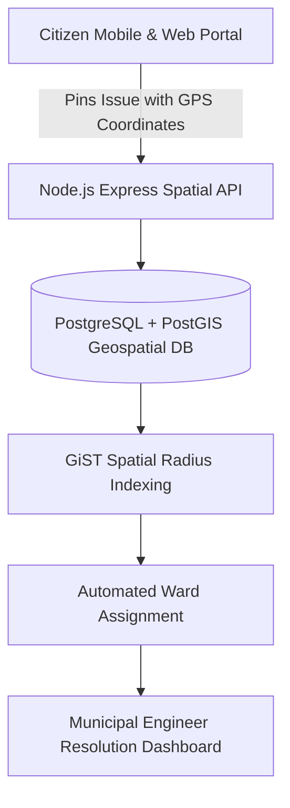

# Namma Kalam — AI Civic Reporting & Geospatial Platform 🏙️🗺️

[](https://nodejs.org/)
[](https://expressjs.com/)
[](https://postgis.net/)
[](LICENSE)

> **Namma Kalam** is an AI-powered municipal civic reporting and geospatial resolution platform built with **Node.js**, **Express**, and **PostGIS**. Enables citizens to pin and document civic grievances (potholes, garbage hazards, water pipeline bursts) with automated geospatial ward indexing, severity classification, and municipal tracking.

---

## 🌟 Key Highlights

- **PostGIS Geospatial Engine**: Radius queries (`ST_DWithin`), boundary polygons (`ST_Contains`), and spatial indexing using GiST.
- **Smart Civic Triage**: Automated priority and severity categorization based on report density and crowd upvotes.
- **Ward-Level Allocation**: Automated assignment to local municipal administrative zones and ward engineers.
- **RESTful GeoJSON APIs**: Standardized spatial payload exchanges for GIS mapping overlays.

---

## 🏗️ System Architecture



---

## 🛠️ Quick Start

```bash
git clone https://github.com/Dk043131/namma-kalam.git
cd namma-kalam
npm install
npm start
```
API running on `http://localhost:5000`.

---

## 📄 License
This project is open-source under the [MIT License](LICENSE).
